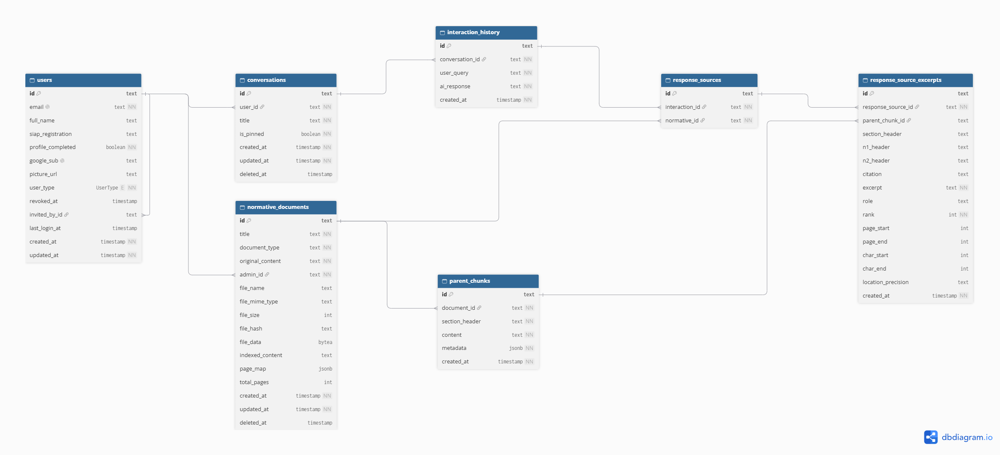

# Modelagem do banco de dados

Modelo de dados do backend do GeFi (PostgreSQL 16 + pgvector), derivado do
`schema.prisma` do projeto. As tabelas de auditoria (`system_audits`) foram
deixadas de fora porque ainda não foram implementadas, e a tabela de feedback de
conversas (`conversation_feedbacks`) foi removida por não fazer parte do sistema.

## Arquivos

| Arquivo | Conteúdo |
|---|---|
| `schema.sql` | DDL PostgreSQL gerado a partir do `schema.prisma` do backend |
| `schema.png` | Diagrama entidade-relacionamento |

## Diagrama entidade-relacionamento



## Visão geral

O modelo se organiza em três grupos:

- **Usuários e acesso** (`users`): a autenticação é feita pelo Google, então a tabela
  guarda apenas a autorização (cargo e convite) e os dados institucionais. Uma linha sem
  `google_sub` representa um convite pendente. O acesso é revogado com `revoked_at`, sem
  excluir o registro, para preservar a rastreabilidade.
- **Base normativa** (`normative_documents`, `parent_chunks`): os documentos enviados por
  administradores ficam com o arquivo original, o texto indexado e um mapa de páginas. Os
  *parent chunks* são as seções usadas como contexto na estratégia de recuperação
  hierárquica (*parent document retrieval*).
- **Conversas e rastreabilidade** (`conversations`, `interaction_history`,
  `response_sources`, `response_source_excerpts`): cada pergunta
  e resposta fica registrada com os documentos citados (`response_sources`) e os trechos
  que de fato entraram no prompt (`response_source_excerpts`), com localização por
  página e por caractere.

## Dicionário de dados

Todas as chaves primárias são UUID armazenado como `text`.

### `users`

| Coluna | Tipo | Nulo | Descrição |
|---|---|---|---|
| `id` | text | não | PK |
| `email` | text | não | Único, em minúsculas. É a chave do convite |
| `full_name` | text | sim | Preenchido pela pessoa no primeiro acesso |
| `siap_registration` | text | sim | Matrícula SIAPE |
| `profile_completed` | boolean | não | Padrão `false` |
| `google_sub` | text | sim | Único. Identificador estável da conta Google; nulo enquanto o convite não for usado |
| `picture_url` | text | sim | Foto do perfil Google |
| `user_type` | `UserType` | não | `ADMINISTRADOR` ou `FISCAL` (padrão `FISCAL`) |
| `revoked_at` | timestamp | sim | Se preenchido, o login é recusado |
| `invited_by_id` | text | sim | FK → `users.id` (`ON DELETE SET NULL`) |
| `last_login_at` | timestamp | sim | |
| `created_at`, `updated_at` | timestamp | não | |

### `conversations`

| Coluna | Tipo | Nulo | Descrição |
|---|---|---|---|
| `id` | text | não | PK |
| `user_id` | text | não | FK → `users.id` |
| `title` | text | não | |
| `is_pinned` | boolean | não | Padrão `false` |
| `deleted_at` | timestamp | sim | Exclusão lógica |
| `created_at`, `updated_at` | timestamp | não | |

### `interaction_history`

| Coluna | Tipo | Nulo | Descrição |
|---|---|---|---|
| `id` | text | não | PK |
| `conversation_id` | text | não | FK → `conversations.id` |
| `user_query` | text | não | Pergunta do usuário |
| `ai_response` | text | não | Resposta gerada |
| `created_at` | timestamp | não | |

### `normative_documents`

| Coluna | Tipo | Nulo | Descrição |
|---|---|---|---|
| `id` | text | não | PK |
| `title` | text | não | |
| `document_type` | text | não | |
| `original_content` | text | não | Texto extraído do documento |
| `admin_id` | text | não | FK → `users.id` (quem enviou) |
| `file_name`, `file_mime_type` | text | sim | Arquivo original (nulo em documentos antigos) |
| `file_size` | int | sim | Em bytes |
| `file_hash` | text | sim | SHA-256 do arquivo original |
| `file_data` | bytea | sim | Conteúdo binário do arquivo |
| `indexed_content` | text | sim | Texto limpo usado na indexação; referência para os offsets `char_start`/`char_end` |
| `page_map` | jsonb | sim | Lista `{page_start, page_end, start, end}` em coordenadas de `indexed_content` |
| `total_pages` | int | sim | |
| `deleted_at` | timestamp | sim | Exclusão lógica |
| `created_at`, `updated_at` | timestamp | não | |

### `parent_chunks`

| Coluna | Tipo | Nulo | Descrição |
|---|---|---|---|
| `id` | text | não | PK |
| `document_id` | text | não | FK → `normative_documents.id` (`ON DELETE CASCADE`) |
| `section_header` | text | não | Cabeçalho da seção |
| `content` | text | não | Texto da seção |
| `metadata` | jsonb | não | Título, cabeçalhos N1/N2 e localização (`char_start`, `char_end`, `page_start`, `page_end`) |
| `created_at` | timestamp | não | |

### `response_sources`

Um registro por **documento** citado em uma resposta.

| Coluna | Tipo | Nulo | Descrição |
|---|---|---|---|
| `id` | text | não | PK |
| `interaction_id` | text | não | FK → `interaction_history.id` |
| `normative_id` | text | não | FK → `normative_documents.id` |

### `response_source_excerpts`

Um registro por **trecho** que entrou no prompt. Os campos de localização são opcionais
porque documentos indexados antes dessa funcionalidade não os têm.

| Coluna | Tipo | Nulo | Descrição |
|---|---|---|---|
| `id` | text | não | PK |
| `response_source_id` | text | não | FK → `response_sources.id` (`ON DELETE CASCADE`) |
| `parent_chunk_id` | text | sim | FK → `parent_chunks.id` (`ON DELETE SET NULL`) |
| `section_header`, `n1_header`, `n2_header` | text | sim | Hierarquia do trecho no documento |
| `citation` | text | sim | Referência legível do dispositivo |
| `excerpt` | text | não | Texto do trecho |
| `role` | text | sim | Papel do trecho no contexto |
| `rank` | int | não | Ordem de relevância (padrão 0) |
| `page_start`, `page_end` | int | sim | Páginas no arquivo original |
| `char_start`, `char_end` | int | sim | Offsets em `normative_documents.indexed_content` |
| `location_precision` | text | sim | Precisão da localização obtida |
| `created_at` | timestamp | não | |

### Tipo enumerado `UserType`

`ADMINISTRADOR`, `FISCAL`.

## Fora do Prisma: tabela de vetores

Os *embeddings* dos trechos menores (*child chunks*) ficam na tabela
`documentos_vetorizados`, criada e gerenciada pelo `PGVectorStore` do LangChain, e não
pelo Prisma. Ela tem as colunas `id`, `embedding` (vetor pgvector), `text` e `metadata`
(jsonb). A ligação com o modelo relacional é lógica: `metadata->>'documentId'` aponta
para `normative_documents.id` e `metadata->>'parentId'` para `parent_chunks.id`. Por isso
ela não aparece no diagrama nem no `schema.sql`.

## Como recriar o banco

```bash
psql "$DATABASE_URL" -f schema.sql
```

Ou, no projeto backend, com o Prisma: `npx prisma migrate deploy`.
